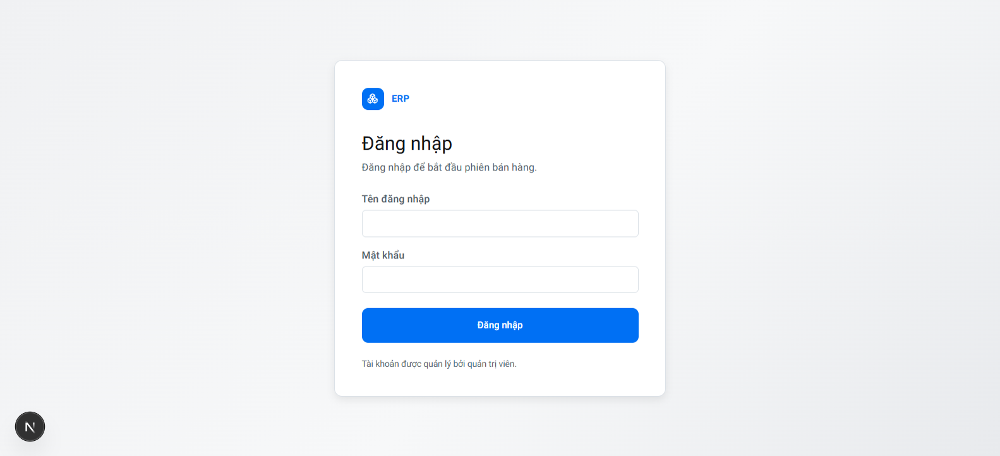

# Simple ERP — Open-source POS & Inventory Management

Simple ERP is an open-source ERP and point-of-sale (POS) system for small retail businesses. Manage products, inventory and stock, sales, orders, customers, and customer debt through the web app or Windows desktop app. Desktop mode supports offline use with a local database or PostgreSQL/Supabase.

Ứng dụng ERP quản lý bán hàng, kho, sản phẩm, đơn hàng, khách hàng và công nợ, có bản web và bản Windows desktop. Bản desktop hỗ trợ cơ sở dữ liệu cục bộ để làm việc ngoại tuyến hoặc kết nối PostgreSQL/Supabase.

## Giao diện

## Hướng dẫn sử dụng

Không cần cài công cụ lập trình. Xem [hướng dẫn cài bản Windows](docs/install-vi.md) để tải và cài ERP từ GitHub Releases.

## Dành cho người phát triển

Xem [hướng dẫn chạy mã nguồn và build](docs/development-vi.md).

## Bảo mật và dữ liệu

- Không commit `.env.local`, database dumps, bản sao lưu, dữ liệu khách hàng hoặc khóa API.
- `SUPABASE_SERVICE_ROLE_KEY` và mật khẩu PostgreSQL chỉ được dùng phía server/desktop backend.
- Bản desktop mã hóa thông tin kết nối bằng Windows Secure Storage và giữ dữ liệu offline trong thư mục dữ liệu riêng của người dùng.
- Cơ sở dữ liệu mới ở chế độ desktop tạo tài khoản `admin/admin` một lần. Hãy đổi mật khẩu trước khi nhập dữ liệu thật.
- Đổi cơ sở dữ liệu không sao chép dữ liệu; luôn sao lưu và chọn đúng đích trước khi xác nhận migration.
